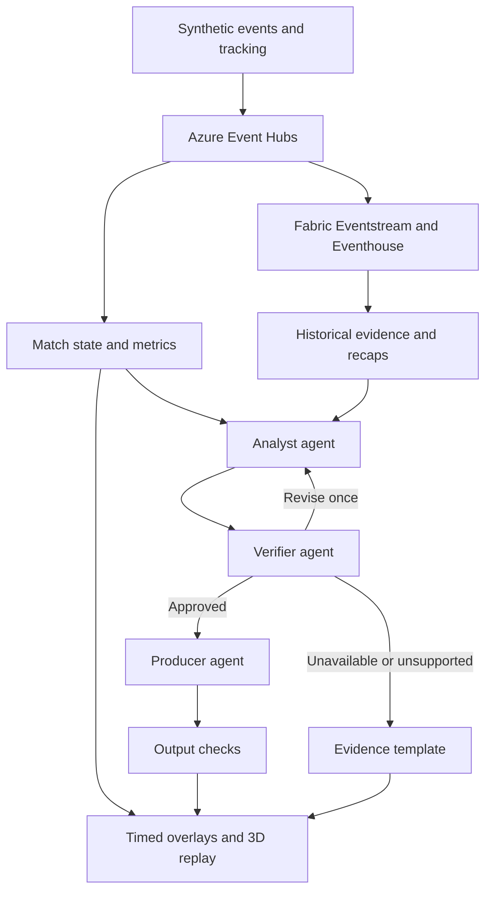

**TactiStream — See the move behind the moment.**

Enhanced build plan for Microsoft + Premier League: Inside the Game. Prepared 13 October 2026.

TactiStream turns a live synthetic football feed into evidence-backed tactical stories, synchronized 3D replays, and personalized recaps. The central experience is “Why Mode”: reveal the off-ball movement, pressure change, or passing sequence that makes a moment worth watching.

This is a proposal for a competitive submission, not a guarantee of winning. All performance thresholds below are engineering targets, not measured results. The schedule assumes focused daily work by one experienced builder; a team can divide ownership without expanding the scope.

**The strategic change is to make the explanation the product.** Your original plan has valuable ingredients, but it makes arbitrary-video understanding the dependency for everything else. Player detection, identity recovery, camera calibration, ball tracking, tactical inference, and video synchronization are several difficult projects. Build the complete event-to-explanation experience first. Connect video through an explicit adapter later.

The central promise should be: “Understand the move behind the moment, see the evidence, and watch the explanation in your own viewing mode.” Avoid promising full tactical reconstruction from any video.

**The verified event constraints shape the build.** The official rules require synthetic football-realistic data, a new project, a public GitHub repository, a working judging experience, and a demo video under two minutes. Teams may have up to four members. Materials need English or English translations. Best Multi-Agent System is an actual category. Each of the five judging criteria has equal weight. Use permitted assets and keep judging access available through 10 November, Pacific Time. [Official rules](https://github.com/microsoft/insidethegamehackathon/blob/main/OFFICIAL%20RULES.md)

The user-provided deadline information converts to 21 October 2026 at 12:30 a.m. IST for registration, and 28 October at 12:29 p.m. IST for submission. Set an internal submission target of 26 October. Treat Innovation Studio instructions and subsequent organizer updates as authoritative if they change the published requirements.

| Judging dimension | Evidence TactiStream should present |
|---|---|
| Technological Implementation | Running data pipeline, reproducible simulator, documented contracts, measured latency, real Azure integrations |
| Agentic Design & Innovation | Distinct agent decisions, evidence handoffs, rejected claims, bounded recovery, comparison against one agent |
| Real-World Impact & Applicability | A concrete studio-production workflow and a timed editing exercise |
| User Experience & Presentation | A memorable replay, readable overlays, one-click personalization, a clear 115-second demonstration |
| Adherence to Hackathon Category | Demonstrated collaboration with shared state and recovery in the multi-agent entry |

These proposed demonstrations are the implementation strategy; they are not additional organizer requirements.

**Build one unforgettable sequence.** Use fictional Blue and Amber teams. In a short synthetic sequence, Blue 9 makes a diagonal off-ball run. An Amber defender moves with the runner, a passing channel widens, Blue 8 receives a forward pass, and the possession ends with a shot. Show measured movement and passing geometry. Describe the run as contributing to space creation, rather than asserting that positional correlation proves a defender’s intention.

The viewer flow should be:

1. Start an immediately playable synthetic match; no upload is needed to understand the product.
2. A restrained card appears: “Space opened before the shot.”
3. Select “Why?” to replay the preceding 8–12 seconds on a simplified 3D pitch.
4. Highlight the runner, the defender’s path, and the measured opening.
5. Expand “Evidence” to inspect timestamps, coordinates, metrics, and source events.
6. Switch Fan to Analyst, then English to Hindi, while retaining the same facts.
7. Pin Blue 9 and generate a player-focused recap that includes the off-ball contribution.

Example Fan wording: “Blue 9’s run helped create room for the pass.”

Example Analyst wording: “The defender shifted toward Blue 9 while the central channel widened. The next forward pass used that space.”

Use exact distances only when the metric service supplies them. Show “Interpretation” on tactical conclusions and “Synthetic” on the match source. A missing tracking interval should produce “Insufficient tracking for this explanation,” with the ordinary event card still available.

**Keep the scope small enough to finish.**

| Scope | Deliverable | Completion condition |
|---|---|---|
| Essential | Seeded synthetic event and position stream | Replay at 1× speed with pause, reset, and a new seed |
| Essential | Live state and tactical metrics | Explainable calculations with event references |
| Essential | Why Mode | One polished replay plus two additional event patterns |
| Essential | Three-agent workflow | Real handoffs and a visible rejected or revised claim |
| Essential | Simplified 3D pitch | All visible positions come from supplied or synthetic tracking |
| Essential | Fan and Analyst views | Different detail and interaction, consistent underlying facts |
| Essential | Player pinning | Focus changes the selected stories and recap |
| Essential | English and Hindi | Reviewed terminology; numbers and identities preserved |
| Essential | Automated recap | Ranked replay playlist, concise text, and timed overlay JSON |
| Essential | Deployed demo and evidence page | Fresh session works; measured results and limitations are visible |
| After essentials | MP4 recap from your own rendered match | Export succeeds with matching timestamps and permitted assets |
| After essentials | Uploaded permitted clip | Explicit alignment to a matching event feed |
| Later | Screen-share capture | Explicit user selection and a clearly scoped observation pipeline |
| Later | Next-action forecasting | Evaluated model or clearly labeled heuristic suggestions |
| Later | Full video auto-eventing | Detection, tracking, calibration, and identity each evaluated separately |

A video accompanied by synthetic events must not be portrayed as the source of those events. Label the adapters separately: “synthetic replay,” “event feed aligned to video,” or “video-derived observations.” If alignment is unknown, show a separate timeline rather than pretending it is synchronized.

**Use a small Microsoft architecture with a fast live path.**



The live state service and Fabric consume the same stream through separate consumer groups. Maintain the event-to-overlay path without waiting for a historical query or an LLM. Fabric supports the durable analytical record, match summaries, and evaluation dashboards. Use as-of filters and state versions when historical tools contribute evidence to a live narrative.

Microsoft documents Event Hubs as a Fabric Eventstream source and Eventhouse as an analytical store for streaming data. [Event Hubs connector](https://learn.microsoft.com/en-us/fabric/real-time-intelligence/event-streams/add-source-azure-event-hubs) · [Fabric Real-Time Intelligence](https://learn.microsoft.com/en-us/fabric/real-time-intelligence/overview)

| Component | Proposed choice | Responsibility |
|---|---|---|
| Frontend | React, TypeScript, Three.js | Video/replay surface, pitch, timeline, accessibility, viewing modes |
| API and match service | Python, FastAPI, Azure Container Apps | Validate events, update state, compute metrics, stream UI messages |
| Event transport | Azure Event Hubs | Match-partitioned feed and independent consumers |
| Analytics | Fabric Eventstream, Eventhouse, KQL | Persist facts, query history, inspect latency and errors |
| Agent runtime | Microsoft Agent Framework with models through Microsoft Foundry | Typed handoffs, bounded retries, model calls and tools |
| Files | Azure Blob Storage | Synthetic datasets, replay artifacts, exports, checkpoints |
| Observability | Application Insights and OpenTelemetry | Trace IDs, latency, token use, retries and fallback reasons |
| Delivery | GitHub, Copilot, Actions | Versioned code, reproducible setup, tests and deployment |

Microsoft Foundry supports managed agents, tools, and observability. Agent Framework documents orchestration, checkpoints, and workflow traces. Choose one orchestration approach, pin its version, and smoke-test the selected model deployment on day one. [Foundry overview](https://learn.microsoft.com/en-us/azure/foundry/agents/overview) · [Agent Framework workflows](https://learn.microsoft.com/en-us/agent-framework/workflows/) · [Workflow observability](https://learn.microsoft.com/en-us/agent-framework/workflows/observability)

Use one always-ready Container Apps instance for the single-match demonstration. It can serve the API and WebSocket connections; reconnect using the last sequence number and a fresh snapshot. Container Apps supports WebSocket ingress. Before claiming multi-instance scale, separate connection fan-out from match ownership and introduce durable coordination. [Ingress documentation](https://learn.microsoft.com/en-us/azure/container-apps/ingress-overview)

Defer AKS unless you already operate it well. Defer Cosmos DB until persistent profiles, distributed match state, or agent checkpoints justify it. These are scope decisions, not claims that those services are unsuitable.

Do not make Azure Custom Vision the centerpiece of a new sports tracking system. Microsoft lists its retirement for 25 September 2028, and generic image detection does not supply player identity, complete pitch positions, or tactical understanding. A future video worker needs an explicitly evaluated sports vision pipeline. [Custom Vision migration guidance](https://learn.microsoft.com/en-us/azure/ai-services/custom-vision-service/migration-options)

**Make the synthetic data a serious engineering contribution.** Create a deterministic simulator, not a prompt that invents arbitrary coordinates. It should have a possession state machine, legal transitions between event types, bounded trajectories, consistent attack directions, plausible player speeds, and a ball path consistent with each completed pass.

Use a model pitch of 105 × 68 metres as your simulator convention. Record that convention; do not imply every stadium uses identical dimensions. Represent stadium-fixed positions and normalize attacking direction in metric calculations. Keep player IDs stable across a simulation.

Generate events and position frames as separate streams:

| Record | Required information |
|---|---|
| Match metadata | Fictional roster, team IDs, pitch dimensions, period, attacking direction, generator version |
| Event | Event ID, match ID, sequence, period clock, event type, team/player IDs, outcome, coordinates, provenance |
| Tracking frame | Capture time, player and ball positions, visibility/availability, source type |
| Evidence metric | Definition/version, time window, value, units, contributing event/frame IDs |
| Insight | Claim IDs, evidence references, factual vs interpretive status, state version, expiry |
| Overlay | Target clock, start/end time, priority, location, text, supported annotations, provenance |

Start with three short scenario families: off-ball space creation, a pressing trap followed by a turnover, and a switch of play that escapes local pressure. Add negative examples: a run that opens no useful channel, pressure without a turnover, and a switch that is immediately closed down.

Separate development and evaluation seeds. Also vary scenario structure for evaluation; merely changing random numbers in the identical scripted play is a weak generalization test. Keep scenario labels and future outcomes out of agent inputs. Synthetic performance is evidence about this controlled environment, not proof of professional-match accuracy.

A minimal event contract can look like this:

```json
{
  "schema_version": "1.0",
  "match_id": "demo-blue-amber-001",
  "event_id": "evt-0042",
  "sequence": 42,
  "period": 1,
  "period_clock_ms": 882300,
  "session_clock_ms": 42300,
  "event_type": "pass",
  "team_id": "blue",
  "player_id": "blue-08",
  "recipient_id": "blue-11",
  "start_m": [58.1, 32.4],
  "end_m": [71.2, 28.0],
  "outcome": "complete",
  "source": {
    "kind": "synthetic",
    "generator_version": "0.1.0",
    "seed": 42
  }
}
```

Keep internal generation metadata separate from the limited evidence payload sent to agents. Do not expose the scenario’s intended explanation as an input.

**Define metrics before writing narrative prompts.** MVP metrics should be computable, inspectable, and modest in their claims.

| Metric | Proposed calculation | Limitation shown in the product |
|---|---|---|
| Pass completion | Completed passes divided by attempted passes in a specified window | Missing outcomes excluded and counted |
| Forward progress | End minus start along the team’s normalized attack axis | Does not equal chance quality |
| Rhythm | Completed passes per minute and turnovers per minute, shown separately | Activity rate is not a validated momentum measure |
| Local pressure proxy | Distance-based score for nearest opponents to the ball carrier | Geometric heuristic, not an official performance metric |
| Space opening | Change in a defined channel width or receiver’s nearest-defender distance | Supports interpretation; does not prove intent |
| Player contribution | Direct events plus evidence-supported involvement in selected sequences | Not an official assist or a universal player rating |

One transparent pressure prototype is:

```text
P = (100 / 3) × sum(exp(-d_i / 2.5)) for the three nearest defenders
```

Distances are in metres; unavailable defenders contribute no fabricated position. If tracking coverage is insufficient, return unavailable rather than a reassuring low score. The 2.5 m scale is a tunable prototype parameter. Explain the formula and test whether it behaves sensibly; do not present it as a validated football statistic.

Speed requires suitable positions and elapsed time. Never infer a precise player or ball speed from a single event. Likewise, do not label an uncalibrated danger heuristic as xG or a scoring probability.

**Give three agents distinct authority.**

| Agent | Decisions and tools | Output | Prohibited behavior |
|---|---|---|---|
| Analyst | Inspect candidate windows; query trusted metrics and geometry; choose a supported tactical interpretation | Claim list, references, uncertainty, requested visual annotations | Inventing measurements, using future events for a live claim |
| Verifier | Recompute/check references; inspect contradictory evidence; approve, revise or reject | Per-claim verdicts with concise reasons | Treating plausible prose or model confidence as proof |
| Producer | Choose story order and detail; adapt approved claims to audience, player and language; assemble recap | Fan/Analyst text and timed render specification | Changing facts, adding unsupported causality or generating executable UI code |

The match engine handles tracking, metric arithmetic, candidate ranking and rendering. These jobs do not need autonomous agents. The Producer can select highlights from supplied candidates; code enforces their time ranges and source permissions.

Shared state contains the immutable match snapshot, as-of time, metric results, claim ledger, verification verdicts, user preferences, output version and deadline. Each handoff includes IDs and a trace ID. Log decisions and tool results, not private model reasoning.

Use a bounded workflow: Analyst → Verifier → Producer → deterministic output checks. Permit one repair request when time remains. A timeout, failed evidence check, or expired output produces a factual template from validated events. The UI keeps its basic metrics while a narrative is unavailable.

The final output checks are essential because a Producer can introduce an unsupported claim after verification. Validate names, numbers, units, evidence references, timestamps and permitted annotations. Keep the Producer within approved claim templates; reject anything that adds a new factual proposition.

Starter instructions:

- Analyst: “Use only the provided as-of snapshot and registered evidence tools. Separate observed facts from interpretation. Every factual claim needs event or metric IDs. Choose at most two useful claims. If the required positions are absent, abstain from the spatial explanation.”
- Verifier: “Check every claim against referenced evidence and available counterevidence. Reject absent IDs, future evidence, changed values, and causal certainty unsupported by the data. Return approve, revise, or reject with short reasons. Do not introduce replacement measurements.”
- Producer: “Use only approved claims. Fan mode uses plain language; Analyst mode exposes metrics and evidence. Preserve identities, numbers, units and uncertainty across languages. Output the fixed overlay schema and respect its timing budget.”

Implement ordinary typed tools first: get_match_snapshot, get_event_window, get_metric, inspect_geometry, and build_recap_candidates. Enforce as-of access on the server. If useful and time permits, expose these same read-only contracts through MCP; protocol decoration alone is not a product advantage.

**Make rendering a real integration boundary.** Produce machine-readable insight packets rather than arbitrary agent-generated HTML. This makes the product useful to a future studio graphics system, even though no partner integration is claimed.

```json
{
  "schema_version": "1.0",
  "insight_id": "ins-0042",
  "match_id": "demo-blue-amber-001",
  "state_version": 42,
  "as_of_session_ms": 42300,
  "mode": "fan",
  "language": "en",
  "source_kind": "synthetic",
  "claim_status": "interpretation_supported",
  "title": "Space opened before the pass",
  "body": "Blue 9's run helped create room for the forward pass.",
  "evidence_ids": ["evt-0041", "evt-0042", "metric-channel-0042"],
  "render": {
    "clock": "session_clock_ms",
    "show_from_ms": 43000,
    "show_until_ms": 49000,
    "priority": 2,
    "panel": "lower_third",
    "annotations": ["highlight_blue_09", "show_channel_0042"]
  }
}
```

This is an illustrative contract, not a measured output. Annotations reference validated scene data. The model never invents their coordinates. Availability time and expiry must be checked before display; a late packet belongs in the timeline or replay rather than flashing over a different live moment.

For synchronized video, retain period clock, session clock, media presentation timestamp, and the alignment mapping. A real broadcast can contain stoppages, replays, and cuts, so do not assume wall clock equals match clock or that one global offset always works. The self-rendered synthetic demo can share a single controlled clock.

**Keep the screen calm and the evidence one click away.** Use a dark slate broadcast surface, a readable green pitch, and two distinct team colors with text labels. Give the match or replay most of the screen. Show only one insight card at a time; keep detailed metrics in the Analyst drawer.

The top bar holds match clock, source status, viewing mode and language. The main surface switches between match and tactical replay. A side panel holds the explanation, selected player and evidence. The bottom timeline marks key moments and supports keyboard seeking.

Fan mode should use plain-language cards, a simple emphasis animation, and fewer numbers. Analyst mode should show time windows, metric definitions and evidence references. Pinned-player mode should change the timeline ranking and recap selection, rather than merely adding a name to the header.

Use a persistent synthetic-source badge. Show “Partial tracking” when relevant. Avoid noisy confidence percentages that have no calibration. Use evidence states such as verified facts, supported interpretation, or insufficient data.

**Treat reliability as part of the demonstration.** Partition event traffic by match. Deduplicate by event ID, check sequence ordering, and buffer modest out-of-order delivery. Reconcile late events through state revisions; expire or replace affected cards rather than silently retaining a disproved statement.

Persist a resumable checkpoint and archive the original feed. During reconnection, recover a snapshot and replay later events. A repeated event must not inflate pass counts. Cache validated story variants by match, insight version, audience and language so each viewer does not trigger new model calls.

Set a narrative deadline of eight seconds from the triggering event’s server receipt. Show basic event information earlier. If the deadline is missed, use a validated factual template and retain the generation attempt only in diagnostics. Display measured narrative age where relevant.

Evaluate on a modest controlled workload before claiming scale: one match, its full tracking stream, ten simultaneous viewers, and a representative set of generated story moments. Scaling beyond that remains a roadmap item.

**Measure the claims that judges can challenge.**

| Measure | Proposed release gate | Measurement method |
|---|---|---|
| Fast overlay latency | p95 at or below 2 seconds | Server receipt to browser display acknowledgement |
| Narrative latency | p95 at or below 8 seconds, with timeout rate reported separately | Trigger receipt to validated narrative display; count fallback separately |
| Reference and numeric integrity | All released cards pass deterministic checks | Compare IDs, units and values against the frozen snapshot |
| Tactical support | Target at least 95% supported claims on the reviewed synthetic set | Blind manual review, with counts and disagreement reported |
| UI responsiveness | At least 30 fps on the named demo machine | Browser performance capture during replay |
| Replay consistency | Identical metric state for identical inputs | Repeat replay with shuffled/duplicated delivery |
| Failure handling | All enumerated failure fixtures degrade usefully | Missing positions, late events, model timeout, bad claim, reconnect |
| Economics | Measured usage per match and per validated story | Tokens, calls, compute time, storage, capacity and egress |

These targets are hypotheses until you run the tests. Report actual results, sample sizes, hardware, network conditions and failures. Do not silently omit timed-out narratives from latency statistics.

Prepare about 30 held-out short scenarios, including negative and missing-data cases. Review at least 100 atomic claims across outputs if feasible. If no football expert is available, label the review as internal rather than expert validated. Report coverage alongside accuracy so that abstaining on everything cannot look like success.

To justify multiple agents, compare three configurations on the same frozen inputs: a deterministic summary, one agent with the same tools, and the proposed three-agent workflow. Score support, useful coverage, latency, cost and recovery. Include a fixed-total-token comparison where practical. If the multi-agent version costs more without useful quality improvement, revise the workflow or narrow the claim.

Do not include next-action percentages in the MVP. A later forecast must use information available at the forecast time and be evaluated on held-out sequences against simple baselines. A scenario comparator may show plausible options with heuristic scores, clearly labeled as such.

**Follow a calendar with stop rules.**

| Dates, IST | Work | Required exit condition |
|---|---|---|
| 13 October | Access, scope, schema, model deployment, Fabric permissions, repo | One event reaches a browser and one real Foundry call succeeds |
| 14–15 October | Simulator, replay controls, event validation, live state | Seeded feed produces stable metrics and a basic UI |
| 16–17 October | Analyst, Verifier, Producer, output checks, trace view | A supported card appears; an unsupported claim is blocked |
| 18–19 October | Why Mode, simplified 3D, evidence drawer, player focus | The off-ball sequence works end to end |
| 20–21 October | Fan/Analyst differences, English/Hindi, recap playlist, Fabric analysis | All five pipeline stages are usable in the deployed app |
| 22–23 October | Held-out evaluation, failure cases, agent comparison, measured usage | Honest results table and useful fallback behavior |
| 24 October | UI polish, documentation, optional export only if stable | Feature freeze |
| 25 October | Record the 115-second demo, fresh-session rehearsal | Clear recording and working judge instructions |
| 26 October | Submit and verify project links | Submission completed with time to resolve access issues |
| 27 October | Buffer and final availability checks | No risky new features |

If access is blocked on day one, continue local fixtures while resolving it, and remove any unimplemented service from the final architecture claims. If Why Mode is not stable by 19 October, cut upload, screen sharing and forecasts completely. If language output is weak by 21 October, use reviewed templates for two languages. Keep the working demo available for the judging period; do not depend on an expiring trial without checking its dates.

A team can assign data/metrics, agent/backend, frontend/replay, and evaluation/demo ownership. A solo builder should keep the same order and defer all “after essentials” work unless the release gates are already met.

**Use the first seconds of the demo to show the value.** The target duration is 1 minute 55 seconds.

| Time | Screen action | Narration intent |
|---|---|---|
| 0:00–0:08 | Show the shot, then the Why card | “The shot is obvious. The run that opened the space is easier to miss.” |
| 0:08–0:30 | Rewind in 3D; highlight runner, defender and channel | Explain the invisible contribution using visible evidence |
| 0:30–0:43 | Expand the evidence drawer | Show factual measurements and the interpretation distinction |
| 0:43–0:58 | Change Fan to Analyst; switch to Hindi; pin the runner | Same facts, different useful experiences |
| 0:58–1:13 | Load an unseen seed or alternate sequence | Show the running system handles a second example |
| 1:13–1:28 | Trigger a labeled missing-data or timeout fixture | Show a blocked claim and a useful fallback |
| 1:28–1:45 | Generate recap and inspect timed overlay output | Connect the experience to a studio workflow |
| 1:45–1:55 | Show measured results and the live project link | State the product value and actual deployed stack |

Use the screen recording of the working app. If a backup recording or cached replay is used during a presentation, label it. Lead with the moment, not a long file-upload sequence or architecture slide.

A concise positioning line is: “TactiStream turns a football event stream into a tactical story you can inspect, replay, and personalize.”

For the submission description, explain the synthetic source, the three real agent responsibilities, the deterministic evidence checks, the rendered result, the measured limits, and how a studio could use the output. Avoid claiming official Premier League integration or production accuracy.

**Choose one initial buyer.** Target a digital football producer preparing tactical segments and short recaps. The job is to find a meaningful moment, verify an explanation, and prepare versions for different audiences. Analysts and fans use the result, but the producer is the first buyer hypothesis.

Proposed pilot: ask a small number of willing producers or editors to create explanations for the same clips with and without the tool, counterbalancing the order. Measure time to publishable output, correction count, and reviewer acceptance. Do not announce customer validation before conducting it.

A simple value model is:

```text
Monthly net time-saving value =
(manual minutes - assisted minutes) × moments per month × hourly labor cost / 60
- monthly operating cost
```

Consider pricing per production workspace plus match usage after validating the pilot. Keep match-level analysis shared across viewers; per-viewer personalization should mostly choose cached validated variants. Track inference, container, Event Hubs, Fabric capacity, storage and egress separately. Any spending ceiling you choose is a budget decision, not a cloud price estimate.

The defensible assets would be the evidence-linked tactical evaluation set, the rendering contract, reproducible replay infrastructure, and measured editorial workflow improvements. Three-dimensional graphics alone are easy to imitate.

**Finish with proof that someone else can run it.** The repository should include setup instructions, pinned dependencies, an environment-variable example without secrets, synthetic generator and fixtures, typed contracts, agent instructions, metric definitions, deployment configuration, evaluation results, permitted-asset notes, and a compact architecture explanation.

Document what runs live, what is synthetic, what is cached, and what remains planned. Include a single-click or single-command seeded demo route. Make the demo resettable without editing the database. Show the actual model deployment and region in technical documentation, while keeping unnecessary implementation detail out of the fan experience.

The first build milestone is deliberately small: one synthetic pass enters the pipeline, one verified explanation reaches the browser, and one evidence reference opens correctly. Establish that complete loop before spending time on the stadium, screen sharing, or forecasting.

**Additional source references, checked 13 October 2026.**

- [Event landing page supplied in the request](https://events.microsoft.com/flow/microsoft/plmshackathon/registration/page/landing)
- [Microsoft’s official hackathon repository](https://github.com/microsoft/insidethegamehackathon)
- [Agent Framework checkpoint documentation](https://learn.microsoft.com/en-us/agent-framework/workflows/checkpoints)
- [Microsoft Reactor: Inside the Game](https://developer.microsoft.com/en-us/reactor/series/S-1709/)

The event rules and service capabilities above come from primary Microsoft sources. Product positioning, scope, metrics, timeline, architecture choices and release gates are proposed design decisions. No implementation or benchmark results are claimed by this plan.

