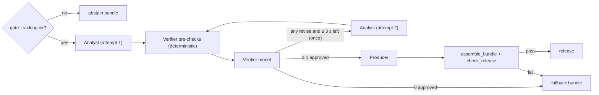

# Implementation Plan: Agent Workflow

**Branch**: `004-agent-workflow` | **Date**: 2026-10-14 | **Spec**: [spec.md](spec.md)

**Input**: Feature specification from `/specs/004-agent-workflow/spec.md`

## Summary

When 003 detects a candidate moment, a background `NarrativeService` builds an immutable `WorkflowContext` (as-of
snapshot, moment, metrics, deadline = trigger receipt + 8 s, trace ID) and runs `explain_moment`: an Agent Framework
workflow of four executors — **Analyst** (chooses ≤ 2 template-bound claims from tool-gathered evidence) →
**Verifier** (deterministic pre-checks, then model judgement on causality and counterevidence; stricter wins) →
optional single **repair** round → **Producer** (picks claims, order, title key, annotations, priority and panel for
Fan and Analyst; no prose) → **release checks** (extended `check_packet`). Text for all four mode × language variants is
rendered deterministically from the narrative catalog, so numbers and identities are identical across languages.
Any timeout, model error, rejection, check failure or expiry releases the 001 factual template path as a labelled
fallback inside the deadline; missing tracking abstains before any model call. Every run yields a public
`AgentTrace` (REST, bus envelope, OTel), results are cached per `(moment_id, state_version)`, and the frontend shows a
stage indicator, Interpretation/Facts-only labels and an Agent trace panel. Two baselines (deterministic, single agent)
share the same tools, templates and checks for evaluation in 008.

## Technical Context

**Language/Version**: Python 3.12 (backend), TypeScript 5.x strict (frontend)

**Primary Dependencies**: `agent-framework` (version pinned in 001 R5) for the Foundry chat client and workflow
executors; azure-identity (`DefaultAzureCredential`); Pydantic v2; jsonschema (via 001 `schema_registry`);
opentelemetry-sdk; React 19 + Zustand (frontend). No new third-party packages.

**Storage**: In-memory `TraceStore` and `NarrativeCache` per session; optional JSON trace files under
`TACTISTREAM_TRACE_DIR`; frozen fixtures in `data/fixtures/`; agent scripts in `data/fixtures/agent_scripts/`.

**Testing**: pytest + pytest-asyncio with `ScriptedModelClient` and 001 `FakeClock` (auto-advancing driver);
httpx ASGI integration tests; `@pytest.mark.live` for Foundry; Vitest + Testing Library; Playwright (scripted mode).

**Target Platform**: Same container as 001 (Azure Container Apps, 1 replica); Foundry deployment in the region recorded in 001 R5.

**Project Type**: Web application (backend + frontend)

**Performance Goals**: narrative p95 ≤ 8 s from trigger receipt with fallback counted separately (target, measured in
008); fallback delivered ≤ 8 s in 100% of timeout fixtures; fast path unaffected (event broadcast ≤ 50 ms after ingest in tests).

**Constraints**: no free-form model text shown to users; no agent arithmetic; server-side as-of enforcement; ≤ 5
model calls per moment (3 without repair); ≤ 2 concurrent runs per match; no scenario labels or `match_id` in agent inputs.

**Scale/Scope**: 1 match, ≤ 10 viewers, ~3–8 explained moments per demo match; 4 prompts; 8 new catalog templates + 9 title keys.

## Constitution Check

*GATE: Must pass before Phase 0 research. Re-check after Phase 1 design.*

| Principle | Status | How |
|---|---|---|
| I Evidence before narrative | PASS | Claims are template IDs + slots + evidence IDs; Verifier pre-checks recompute every slot value with `MetricEngine`; `check_release` blocks unapproved claims, numbers, names, IDs, annotations, causal lexicon; "Interpretation" label; abstain with `status.insufficient_tracking` while fact sentence stays; no confidence percentages (uncertainty is low/medium/high and not shown as a number) |
| II Provenance & synthetic honesty | PASS | Tools strip `match_id`, manifest and labels (audit test SC-011); packets carry `source_kind = synthetic` and `synthetic` label; demo fixtures labelled `demo_fixture` in packets and UI |
| III Deterministic core, bounded agents | PASS | Exactly three agents with distinct authority; one repair loop max; 8 s deadline with deterministic fallback; checks after Producer; tools read-only with as-of enforcement; fast path never awaits the workflow (SC-009) |
| IV Contract-first | PASS | Handoffs use `claim.schema.json` `$defs`; new `agent_trace.schema.json` and additive changes proposed below and applied with examples + TS regeneration in T005–T007 before code |
| V Test-first | PASS | Every implementation task is preceded by a failing test; all agent tests use `ScriptedModelClient` + `FakeClock`; failure fixtures (timeout, bad claim, missing tracking, future evidence, unapproved claim) each have tests |
| VI Measure, don't claim | PASS | Narrative latency recorded for every explained moment with outcome split; live Foundry runs reported with tokens and latency; Agent Framework claim removed from docs if R1 fallback is used |
| VII Scope discipline | PASS | No checkpoints/durable workflow, no MCP server, no Cosmos; in-memory cache and trace store; tool use via executor-built evidence packs instead of a model tool loop (research R2) |

Post-design re-check: PASS (Complexity Tracking empty).

## Project Structure

### Documentation (this feature)

```text
specs/004-agent-workflow/
├── spec.md · plan.md · research.md · data-model.md · quickstart.md · tasks.md
└── contracts/
    ├── agent-io.md      # per-agent inputs/outputs, ModelClient contract, scripts format, prompt design
    ├── tools.md         # AgentTools signatures, payloads, errors, as-of rules, role access
    └── trace.md         # AgentTrace schema, REST/WS/bus surface, fixtures endpoint, example trace
```

### Source Code (repository root)

```text
.env.example                                   + TACTISTREAM_DEMO_FIXTURES, _TRACE_DIR, _AGENT_SCRIPTS, budgets (T002)
contracts/                                      proposed changes C1–C4 applied in T006 (after approval)
├── schemas/agent_trace.schema.json             new
├── schemas/{claim,insight_packet,ws_message,feed_envelope}.schema.json   additive edits
└── examples/agent_trace.json                   new
data/fixtures/
├── hero_space_creation.jsonl                   frozen window of 002 demo match (metadata + events + frames 36.0–47.0 s)
├── hero_missing_tracking.jsonl                 same window, blue-09 & amber-04 invisible 40.0–43.0 s
├── press_turnover.jsonl · switch_escape.jsonl · run_no_channel.jsonl
└── agent_scripts/demo-blue-amber-001.json      ScriptedModelClient replies for the demo + test moments
backend/src/tactistream/
├── settings.py                                 + agent/narrative settings (T004)
├── contracts/{claim.py,insight.py,ws.py}       + SlotValue.value/unit, demo_fixture label, no_supported_claim
├── contracts/trace.py                          AgentTrace, TraceStep, ToolCallRecord, ClaimTraceEntry
├── narrative/
│   ├── templates.py                            TemplateSpec, SlotSpec, Catalog, load_catalog()
│   ├── render.py                               + interp/status templates, derived slots, Catalog-driven precision
│   ├── factual.py                              + build_fallback_bundle(), build_abstain_bundle()
│   └── catalog/{spec.json,en.json,hi.json}     spec.json new; en/hi become text-only
├── agents/
│   ├── model_client.py                         ModelClient, ModelResponse, ModelError, ModelTimeout, FoundryModelClient,
│   │                                           ScriptedModelClient, TimeoutModelClient, FaultInjectingModelClient,
│   │                                           mutate_to_bad_claim(), make_model_client()
│   ├── tools.py                                AgentTools, ToolError, ToolCallRecord sink, evidence-pack recipes
│   ├── context.py                              WorkflowContext, WorkflowDeps, ClaimLedger, ClaimRecord, NarrativePrefs, budgets
│   ├── analyst.py                              build_analyst_input(), run_analyst()
│   ├── verifier.py                             precheck_claims(), build_verifier_input(), run_verifier(), combine_verdicts()
│   ├── producer.py                             build_producer_input(), run_producer(), assemble_bundle()
│   ├── checks.py                               (001) check_packet + check_release(), CAUSAL_LEXICON, new CheckFailure codes
│   ├── workflow.py                             explain_moment(), build_workflow(), WorkflowResult, make_runner(), build_context()
│   ├── service.py                              NarrativeService (gate, semaphore, cache, WS status, latency, trace publish), FixtureArm
│   ├── trace.py                                TraceRecorder, TraceStore, trace_envelope()
│   (moments/annotation_ids.py                  ParsedAnnotation, parse_annotation_id(), annotation_id_for() — shared with 005)
│   (moments/annotations.py                     ResolvedAnnotation, resolve_annotation() — shared with 005 scene builder)
│   ├── cache.py                                NarrativeCache
│   ├── baselines.py                            DeterministicRunner, SingleAgentRunner, INTERPRETATION_RULES
│   └── prompts/{analyst,verifier,producer,single_agent}.md
├── telemetry/latency.py                        + attribute filters: percentile(kind, p, **where), count(kind, **where)
└── api/
    ├── session.py                              MatchSession: on_moment → NarrativeService.submit; reset → cancel_all
    ├── app.py                                  register routers; /healthz + demo_fixtures
    ├── routes_traces.py                        GET /api/matches/{match_id}/traces/{trace_id}
    └── routes_fixtures.py                      POST /api/matches/{match_id}/fixtures
backend/tests/
├── fixtures/{hero_ids.py,hero_world.py,clock_driver.py}
├── contract/test_agent_contracts.py
├── unit/{test_settings_agents,test_catalog,test_render_interp,test_model_client,test_agent_tools,test_context,
│         test_trace,test_latency_filters,test_analyst,test_verifier_prechecks,test_verifier,test_producer,
│         test_annotations,test_checks_release,test_workflow,test_fault_injection,test_fallback_bundle,
│         test_cache,test_baselines}.py
├── integration/{test_narrative_flow,test_fixtures_api,test_traces_api,test_viewer_cache,test_release_audit}.py
└── live/test_foundry_agents.py                 @pytest.mark.live
frontend/
├── src/api/client.ts                           + getTrace, injectFixture, getHealth
├── src/store/matchStore.ts                     + narrative slice (stage by moment), traces cache, health
├── src/i18n/{en,hi}.ts                         + stage, reason-code, label strings
├── src/components/
│   ├── InsightCard.tsx                         + Interpretation / Facts only / Partial tracking / Demo fixture chips, trace link
│   ├── NarrativeStageIndicator.tsx             new
│   ├── AnalystDrawer.tsx                       new: tabs Evidence | Agent trace (005/006 extend)
│   ├── AgentTrace.tsx                          new
│   └── FixtureControls.tsx                     new
└── tests/
    ├── unit/{InsightCard.labels.test.tsx,NarrativeStageIndicator.test.tsx,AgentTrace.test.tsx,
    │         FixtureControls.test.tsx,matchStore.narrative.test.ts}
    └── e2e/agents.spec.ts
docs/agents.md                                  agent roles, prompts, checks, fallback table, measured results
```

**Structure Decision**: Web application layout from the registry. All agent code sits in `agents/`; narrative text
stays in `narrative/` (shared with 001 and 006). Two modules are added beyond the registry list: `agents/service.py`
(side effects: WS, cache, latency, trace publishing — keeps `explain_moment` free of I/O) and `moments/annotations.py`
(annotation resolution shared by `check_release` and 005's replay scene).

## Key Design Notes

### Workflow graph



Any executor raising `ModelTimeout`/`ModelError`, or the outer deadline guard firing, routes to the fallback.

### Budgets (`agents/context.py`)

| Step | Cap (ms) | Minimum to start (ms) | Setting |
|---|---|---|---|
| Analyst (each attempt) | 3500 | 800 | `TACTISTREAM_ANALYST_TIMEOUT_MS` |
| Verifier model (each attempt) | 2500 | 600 | `TACTISTREAM_VERIFIER_TIMEOUT_MS` |
| Producer | 1500 | 600 | `TACTISTREAM_PRODUCER_TIMEOUT_MS` |
| Release reserve (render + checks + broadcast) | 400 | — | `TACTISTREAM_RELEASE_RESERVE_MS` |
| Repair allowed if remaining ≥ | 3000 | — | `TACTISTREAM_REPAIR_MIN_REMAINING_MS` |

`budget_ms(role) = min(cap[role], remaining_ms − reserve_ms − Σ min_ms[r] for r downstream of role)`; if
`budget_ms(role) < min_ms[role]` the step is skipped with `ModelTimeout`. The outer guard waits at most
`deadline_ms − reserve_ms − now` for the whole graph, then cancels it and releases the fallback.

### Signatures

```python
# agents/model_client.py
Role = Literal["analyst", "verifier", "producer", "single_agent"]
SchemaRef = Literal["AnalystOutput", "VerifierOutput", "ProducerOutput", "SingleAgentOutput"]

@dataclass(frozen=True)
class ModelResponse:
    data: dict[str, Any]
    usage_in: int | None
    usage_out: int | None
    latency_ms: int

class ModelError(Exception):          # kind: "invalid_json" | "schema_invalid" | "transport" | "throttled" | "script_missing"
    kind: str
class ModelTimeout(Exception): ...

class ModelClient(Protocol):
    deployment: str                    # "scripted" for ScriptedModelClient
    async def complete_json(self, role: Role, system: str, user: str, schema_ref: SchemaRef,
                            timeout_s: float) -> ModelResponse: ...

class FoundryModelClient(ModelClient): ...      # Agent Framework chat client + DefaultAzureCredential, structured output
class ScriptedModelClient(ModelClient):
    def __init__(self, replies: Mapping[tuple[Role, str, int], ScriptedReply], clock: Clock) -> None: ...
    calls: list[ScriptedCall]                  # (role, moment_id, attempt, timeout_s) — asserted by cache tests
class TimeoutModelClient(ModelClient):          # enforces timeout_s with the injected Clock
    def __init__(self, inner: ModelClient, clock: Clock) -> None: ...
class FaultInjectingModelClient(ModelClient):
    def __init__(self, inner: ModelClient, arm: FixtureArm, clock: Clock) -> None: ...
def mutate_to_bad_claim(output: AnalystOutput, metrics: Mapping[str, MetricResult]) -> AnalystOutput: ...
def make_model_client(settings: Settings, clock: Clock, arm: FixtureArm) -> ModelClient | None: ...

# agents/tools.py
class AgentTools:
    def __init__(self, snapshot: MatchSnapshot, metrics: MetricEngine, moments: Sequence[CandidateMoment],
                 evidence: EvidenceIndex, sink: Callable[[ToolCallRecord], None]) -> None: ...
    as_of_ms: int
    def get_match_snapshot(self) -> dict[str, Any]: ...
    def get_event_window(self, start_ms: int, end_ms: int) -> dict[str, Any]: ...
    def get_metric(self, metric_id: str) -> dict[str, Any]: ...
    def inspect_geometry(self, kind: GeometryKind, params: dict[str, Any], at_ms: int) -> dict[str, Any]: ...
    def build_recap_candidates(self, prefs: NarrativePrefs) -> dict[str, Any]: ...
    def metric_result(self, metric_id: str) -> MetricResult: ...   # typed access for pre-checks (also recorded)
# tool errors are returned as {"error": code, "detail": str}; codes in contracts/tools.md

# agents/context.py
@dataclass(frozen=True)
class WorkflowContext:
    match_id: str; moment: CandidateMoment; snapshot: MatchSnapshot; as_of_ms: int; state_version: int
    metrics: Mapping[str, MetricResult]; ledger: ClaimLedger; prefs: NarrativePrefs
    trigger_receipt_ms: int; deadline_ms: int; trace_id: str; insight_id: str; insight_version: int
    fixture: FixtureKind | None; deps: WorkflowDeps
    def remaining_ms(self) -> int: ...
    def budget_ms(self, role: Role) -> int: ...

# agents/analyst.py / verifier.py / producer.py
async def run_analyst(ctx: WorkflowContext, attempt: Literal[1, 2]) -> AnalystOutput: ...
def precheck_claims(claims: Sequence[Claim], ctx: WorkflowContext) -> list[Verdict]: ...
async def run_verifier(ctx: WorkflowContext, claims: Sequence[Claim], attempt: Literal[1, 2]) -> list[Verdict]: ...
def combine_verdicts(pre: Verdict, model: Verdict | None) -> Verdict: ...
async def run_producer(ctx: WorkflowContext) -> ProducerOutput: ...
def assemble_bundle(plan: ProducerOutput, ctx: WorkflowContext, *, release_session_ms: int) -> InsightBundle: ...

# moments/annotations.py
@dataclass(frozen=True)
class ResolvedAnnotation:
    annotation_id: str
    kind: Literal["highlight", "path", "pressure_ring", "channel"]
    player_id: str | None; metric_id: str | None
    frame_ids: tuple[str, ...]; window: tuple[int, int]
def resolve_annotation(annotation_id: str, snapshot: MatchSnapshot, window: tuple[int, int],
                       metrics: Mapping[str, MetricResult]) -> ResolvedAnnotation | None: ...

# agents/checks.py (extends 001)
def check_release(bundle: InsightBundle, plan: ProducerOutput | None, ctx: WorkflowContext, now_session_ms: int) -> list[CheckFailure]: ...

# agents/workflow.py
async def explain_moment(moment: CandidateMoment, ctx: WorkflowContext) -> WorkflowResult: ...
RunnerKind = Literal["deterministic", "single_agent", "three_agent"]
class MomentRunner(Protocol):
    kind: RunnerKind
    async def run(self, moment: CandidateMoment, ctx: WorkflowContext) -> WorkflowResult: ...
def make_runner(kind: RunnerKind) -> MomentRunner: ...
def build_context(moment: CandidateMoment, snapshot: MatchSnapshot, metric_engine: MetricEngine,
                  deps: WorkflowDeps, *, trigger_receipt_ms: int, insight_version: int = 1,
                  trace_id: str | None = None, prefs: NarrativePrefs | None = None,
                  fixture: FixtureKind | None = None) -> WorkflowContext: ...

# agents/service.py
class NarrativeService:
    def __init__(self, session: MatchSession, runner: MomentRunner, cache: NarrativeCache, traces: TraceStore,
                 arm: FixtureArm, settings: Settings, clock: Clock) -> None: ...
    def submit(self, moment: CandidateMoment) -> None: ...          # non-blocking; gate + schedule
    async def cancel_all(self) -> None: ...                          # on reset

# agents/cache.py
class NarrativeCache:
    async def run_once(self, key: tuple[str, int], run: Callable[[], Awaitable[WorkflowResult]]) -> WorkflowResult: ...
    def put_bundle(self, match_id: str, bundle: InsightBundle) -> None: ...
    def get_bundle(self, match_id: str, insight_id: str, insight_version: int) -> InsightBundle | None: ...
    def latest_bundles(self, match_id: str) -> list[InsightBundle]: ...
    def next_insight_version(self, match_id: str, insight_id: str) -> int: ...

# agents/trace.py
class TraceRecorder:                    # one per run; appends TraceStep / ToolCallRecord; finalize() -> AgentTrace
class TraceStore:
    def put(self, trace: AgentTrace) -> None: ...
    def get(self, match_id: str, trace_id: str) -> AgentTrace | None: ...
def trace_envelope(trace: AgentTrace, published_ms: int) -> FeedEnvelope: ...

# narrative/factual.py (extends 001 build_fact_bundle)
def build_fallback_bundle(ctx: WorkflowContext, reason: FallbackReason, *, release_session_ms: int) -> InsightBundle | None: ...
def build_abstain_bundle(ctx: WorkflowContext, *, release_session_ms: int) -> InsightBundle | None: ...

# narrative/templates.py
@dataclass(frozen=True)
class TemplateSpec:
    key: str; kind: Literal["fact", "interpretation", "status", "title"]
    slots: Mapping[str, SlotSpec]; required_evidence_kinds: tuple[MetricKind, ...]
    requires_tracking: bool; title_keys: tuple[str, ...]; patterns: tuple[MomentPattern, ...]
class Catalog:
    def spec(self, key: str) -> TemplateSpec: ...
    def keys(self, prefix: str) -> list[str]: ...
    def text(self, key: str, mode: ViewerMode, language: Language) -> str: ...
def load_catalog() -> Catalog: ...      # cached; validates spec.json against en.json / hi.json

# telemetry/latency.py (extends 001)
def percentile(self, kind: str, p: float, **where: str) -> float | None: ...
def count(self, kind: str, **where: str) -> int: ...
```

### Other notes

- **Evidence packs, not a model tool loop**: executors call `AgentTools` per the pattern recipe (data-model.md) and pass
  compact JSON to the model; every call is a `ToolCallRecord` in the trace. Rationale and rejected option in research R2.
- **Claim IDs**: executors overwrite model-supplied `claim_id`s with `ClaimLedger.next_claim_id()` in output order, so
  a model can never collide or skip IDs; the original value is not kept.
- **Stage broadcasts**: `WorkflowDeps.on_stage(stage)` is awaited only for the WS broadcast (`WsHub.broadcast` is a
  non-blocking queue put), never for network I/O.
- **Time domains**: `deadline_ms` and `trigger_receipt_ms` use `Clock.now_ms()` (the clock that stamped
  `server_receipt_ms` in 001 ingest). Packet timings use `session_clock_ms` from the replayer.
- **Fixture effects**: `FaultInjectingModelClient` reads the run's fixture from `FixtureArm.consume(moment_id)` at the
  start of the run; `bad_claim` mutates the Analyst attempt-1 response, `model_timeout` sleeps on the clock forever
  for every Analyst call so `TimeoutModelClient` fires.
- **Scripted mode** gives a full offline demo: `make_model_client` loads `TACTISTREAM_AGENT_SCRIPTS`; unknown
  `(role, moment_id, attempt)` raises `ModelError("script_missing")` → honest fallback.
- **Prompts**: `system = prompt file body + generated "Output contract" (JSON Schema of schema_ref) + eligible
  templates JSON`; `user = compact JSON input`. Full drafts in contracts/agent-io.md.

## Proposed cross-cutting changes (outside this folder; apply in T006 after approval)

| ID | File(s) | Change | Kind |
|---|---|---|---|
| C1 | `contracts/schemas/agent_trace.schema.json`, `contracts/examples/agent_trace.json`, `feed_envelope.schema.json` (`agent_trace` payload `$ref`), `contracts/README.md` table | New AgentTrace contract (contracts/trace.md) | additive |
| C2 | `contracts/schemas/claim.schema.json` `SlotValue` | Optional `value: number` and `unit` (metric unit enum) for metric slots — agent's asserted value, checked by Verifier | additive (1.1) |
| C3 | `contracts/schemas/insight_packet.schema.json` `labels` | Add `demo_fixture` | additive (1.1) |
| C4 | `contracts/schemas/ws_message.schema.json` `NarrativeStatus.fallback_reason` | Add `no_supported_claim` | additive (1.1) |
| C5 | `specs/001-walking-skeleton/contracts/rest-api.md` | Add `POST /api/matches/{match_id}/fixtures` (004); `/healthz` gains `demo_fixtures: bool` | doc |
| C6 | `specs/README.md` registry | Add modules `agents/service.py`, `moments/annotations.py`, `narrative/templates.py`, `narrative/catalog/spec.json`; frontend `AnalystDrawer`, `AgentTrace`; key interfaces `check_release`, `make_runner`, `build_context`, `resolve_annotation`, `assemble_bundle` | doc |
| C7 | 002 / 008 specs | Agent inputs never include `match_id`; evaluation scenario match IDs (`sim-{scenario}-{seed}`) must not be passed to runners other than via `WorkflowContext.match_id` (not serialized to models) | note |

## Complexity Tracking

No violations.
