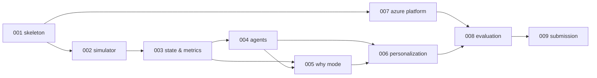

# TactiStream — Spec-Driven Roadmap

> "See the move behind the moment." Source intent: [`TactiStream_Winning_Build_Plan.md`](../TactiStream_Winning_Build_Plan.md).
> Governing rules: [`.specify/memory/constitution.md`](../.specify/memory/constitution.md).

This folder is the single source of truth for **what** we build (spec.md), **how** (plan.md) and
**in what order** (tasks.md). Shared data contracts live in [`/contracts`](../contracts).

## Workflow

1. Pick the next feature from the table below; create branch `NNN-name`.
2. Point Spec Kit at it: `.specify/feature.json` → `{"feature_directory": "specs/NNN-name"}`.
3. Optional: `/speckit-clarify` then `/speckit-analyze` to re-check consistency.
4. `/speckit-implement` (or work the tasks by hand). Every task is TDD: failing test → minimal code → green → commit.
5. Feature is done when every success criterion (SC) is demonstrated and its quickstart runs on a fresh clone.
6. Tick the feature's exit condition below, merge to `main`.

## Feature Map & Calendar (IST, solo builder)

| # | Feature | Dates | Exit condition (binding) |
|---|---|---|---|
| 001 | [walking-skeleton](001-walking-skeleton/spec.md) | 14 Oct | One synthetic pass reaches the browser over WebSocket with a verified factual card; its evidence reference opens; one real Foundry call and one Event Hubs round-trip succeed; CI green |
| 002 | [synthetic-simulator](002-synthetic-simulator/spec.md) | 14–15 Oct | Seeded, deterministic event + 10 Hz tracking streams for 3 scenario families + 3 negatives + missing-data fixture; replay at 1× with pause/reset/new seed |
| 003 | [live-state-metrics](003-live-state-metrics/spec.md) | 15 Oct | Ingest dedupes/reorders; metrics are explainable with event/frame references; candidate moments detected; reconnect resumes from last seq |
| 007a | [azure-platform](007-azure-platform/spec.md) US1–US2 | 15 Oct | Skeleton deployed to Container Apps reading from Event Hubs; telemetry in Application Insights |
| 004 | [agent-workflow](004-agent-workflow/spec.md) | 16–17 Oct | A supported card appears; an unsupported claim is visibly blocked; timeout produces a factual template; trace view works |
| 005 | [why-mode-replay](005-why-mode-replay/spec.md) | 18–19 Oct | Off-ball space-creation sequence works end to end in 3D with evidence drawer; two more patterns replay |
| 006 | [personalized-views](006-personalized-views/spec.md) | 20–21 Oct | Fan/Analyst differ in detail with identical facts; EN/HI switch preserves numbers & identities; pinning changes ranking and recap; recap playlist + overlay JSON |
| 007b | [azure-platform](007-azure-platform/spec.md) US3–US4 | 20–21 Oct | Fabric Eventstream → Eventhouse populated; historical evidence tool answers as-of queries; all pipeline stages usable in the deployed app |
| 008 | [evaluation-evidence](008-evaluation-evidence/spec.md) | 22–23 Oct | Held-out evaluation, failure fixtures, 3-way agent comparison, latency/fps/economics measured; `/evidence` page shows honest results |
| 009 | [submission](009-submission/spec.md) | 24–27 Oct | 24 Oct feature freeze; 25 Oct 115-s demo recorded; 26 Oct submitted; 27 Oct buffer & availability checks |

External deadlines: **register before 20 Oct** (closes 21 Oct 00:30 IST; this is 009 T001 — do it now, ahead of the rest of 009); submission closes 28 Oct 12:29 IST;
judging access must stay up through **10 Nov (Pacific Time)**.

### Stop rules (binding, from the build plan)

- Azure access blocked on any day → continue with local adapters; remove any unimplemented service from architecture claims.
- Why Mode not stable by **19 Oct** → cut upload, screen sharing and forecasts completely (they are already out of MVP).
- Hindi output weak by **21 Oct** → ship reviewed templates only for the two languages (the default design already uses templates).
- No "after essentials" work (MP4 export, aligned video clip) until every essential release gate in 008 passes.

### Cut order when behind (solo builder)

The task lists total ~575 tasks; that is the full plan, not the minimum. Each day, finish the P1 stories of the day's
feature first; drop work in this order:

1. P3 stories (004 US6 baselines are only needed by 008's comparison — keep a minimal deterministic baseline).
2. 007 US4 historical evidence tool (Analyst works without history); 008 second reviewer / kappa; 009 US5 MP4 export.
3. P2 polish stories (extra camera presets, recap download, diagnostics endpoint).
4. Never cut: 001, 002 US1–US2, 003 P1 stories, 004 P1 stories, 005 hero replay, 006 mode/language/pin, 007 US1,
   008 honest results page with whatever was measured, 009 video + submission.

### Dependency graph



## Shared Naming Registry (all specs MUST use these names)

### Repository layout

```text
backend/                      Python 3.12 package `tactistream` (uv project)
  src/tactistream/
    settings.py               Settings (env-driven: bus, agents, Azure endpoints, deadlines)
    contracts/                Pydantic models mirroring /contracts/schemas + schema_registry.py
    simulator/                deterministic match simulator (002)
    transport/                FeedBus protocol, InMemoryBus, EventHubsBus, FeedReplayer (001/002/007)
    state/                    ingest.py Ingestor, match_state.py, snapshot.py MatchSnapshot, checkpoint.py (003)
    metrics/                  MetricEngine + metric modules + geometry (003)
    moments/                  detector, ranking, pipeline (003); annotation_ids.py + annotations.py shared resolver (004);
                              scene.py SceneAnnotations (005); pinned ranking (006)
    agents/                   model_client, tools, context, analyst, verifier, producer, checks, workflow, service,
                              trace, cache, baselines, prompts/ (004)
    narrative/                catalog/{spec,en,hi}.json, render.py, templates.py, factual.py (001/004);
                              consistency.py, preview.py (006)
    recap/                    timing, summary, builder, cache (006)
    history/                  base, memory, eventhouse, tool (get_history), factory (007)
    storage/                  base.py ArtifactStore protocol, local.py (003), blob.py + factory.py (007)
    telemetry/                otel, latency (001); instruments, correlation (007)
    eval/                     evaluation runners, review tool, load tests (008)
    smoke/                    `tactistream-smoke` CLI: Foundry + Event Hubs day-one checks (001)
    api/                      app, session, ws_hub, ws, evidence, routes_* (sessions, evidence, snapshot, replay,
                              traces, fixtures, recap, evaluation, diagnostics) (001+)
  tests/{unit,contract,integration,live}/
frontend/                     Vite + React 19 + TS strict
  src/{contracts,api,store,components,scene,replay,i18n,routes}/   routes: /, /demo (009), /evidence (008)
  tests/{unit,e2e,perf}/
contracts/{schemas,examples}/ canonical JSON Schemas (draft 2020-12) + examples
eval/{scenarios,configs,results,review}/   evaluation data & outputs (008)
infra/                        Bicep (+ fabric/ KQL scripts), azure.yaml at repo root
docs/                         architecture, metrics, agents, limitations, permitted-assets, judge guide
```

### Identifier formats

| Thing | Format | Example |
|---|---|---|
| Match | `demo-blue-amber-001` (hero: space_creation/42/A), `demo-blue-amber-002` (`demo_match`/42/A), `sim-{sha256(config)[:10]}` (other simulator configs — opaque so labels never leak), `eval-{scenario_id}` with opaque `scenario_id` (`ho-01`, `dv-01`) for evaluation | `demo-blue-amber-001` |
| Team | `blue` \| `amber` | `blue` |
| Player | `{team}-{NN}` (shirt number, zero-padded) | `blue-09` |
| Event | `evt-{sequence:04d}` | `evt-0042` |
| Tracking frame | `frm-{frame_index:06d}` | `frm-000423` |
| Metric result | `metric-{kind}-{anchor_sequence:04d}`; per-player `contribution`: `metric-contribution-{seq:04d}-{player_id}` | `metric-channel-0042`, `metric-contribution-0045-blue-09` |
| Candidate moment | `mom-{trigger_sequence:04d}` | `mom-0045` |
| Insight | `ins-{trigger_sequence:04d}` (+ `insight_version` int) | `ins-0045` |
| Claim | `clm-{trigger_sequence:04d}-{n}` | `clm-0045-1` |
| Annotation | `highlight_{team}_{NN}`, `path_{team}_{NN}`, `show_channel_{seq:04d}`, `pressure_ring_{team}_{NN}` | `highlight_blue_09` |
| Trace | W3C trace id (32 lowercase hex) | `4bf92f3577b34da6a3ce929d0e0e4736` |

### Enumerations

- `source.kind`: `synthetic` · `event_feed_aligned_to_video` · `video_derived`
- `event_type`: `kickoff` · `pass` · `carry` · `pressure` · `tackle` · `interception` · `ball_recovery` · `shot` · `clearance` · `out_of_play` · `period_end`
- `outcome`: `complete` · `incomplete` · `on_target` · `off_target` · `blocked` · `goal` · `won` · `lost` · `null`
- Metric `kind`: `pass_completion` · `forward_progress` · `rhythm` · `pressure` · `channel` · `receiver_separation` · `defender_follow` · `off_ball_run` · `contribution`
- Metric `status`: `ok` · `unavailable`
- Moment `pattern`: `space_creation` · `press_turnover` · `switch_escape` · `shot` · `generic`
- Claim `kind`: `fact` · `interpretation`; Verdict `decision`: `approve` · `revise` · `reject`
- Insight `claim_status`: `verified_fact` · `interpretation_supported` · `insufficient_data` · `fallback_template`
- Viewer `mode`: `fan` · `analyst`; `language`: `en` · `hi`
- Feed envelope `kind`: `metadata` · `event` · `frame` · `insight` · `agent_trace` · `latency` (live-state ignores the last three)
- WebSocket server `type`: `snapshot` · `event` · `frame` · `metric` · `moment` · `insight` · `insight_revoked` · `narrative_status` · `ranking` (006, per-connection) · `heartbeat` · `error`;
  client `type`: `resume` · `prefs` · `display_ack`

### Key backend interfaces (signatures every feature relies on)

```python
# transport/bus.py
class FeedBus(Protocol):
    async def publish(self, envelope: FeedEnvelope) -> None: ...
    def subscribe(self, consumer_group: str) -> AsyncIterator[FeedEnvelope]: ...

# simulator/engine.py
def simulate(config: SimulationConfig) -> SimulationOutput: ...   # metadata, events, frames, manifest

# state/match_state.py
class MatchState:
    state_version: int
    def apply(self, envelope: FeedEnvelope) -> StateDelta: ...
    def snapshot(self, as_of_ms: int | None = None) -> MatchSnapshot: ...

# metrics/registry.py
class MetricEngine:
    def compute(self, kind: MetricKind, snapshot: MatchSnapshot, anchor_event_id: str) -> MetricResult: ...

# moments/detector.py
def detect_moments(snapshot: MatchSnapshot, metrics: MetricEngine) -> list[CandidateMoment]: ...

# agents/workflow.py
async def explain_moment(moment: CandidateMoment, ctx: WorkflowContext) -> WorkflowResult: ...

# narrative/render.py
def render_claim(template_id: str, slots: dict[str, SlotValue], mode: ViewerMode, language: Language) -> RenderedText: ...
```

### Clocks & coordinates

- `session_clock_ms` (single controlled clock for the synthetic demo), `period_clock_ms`, and
  `server_receipt_ms` (wall clock at ingest, used only for latency).
- Pitch 105 × 68 m, origin bottom-left; Blue attacks +x in period 1. Metrics use
  `attack_direction` from match metadata to normalize.

## Approved Contract Change Log

Additive (`schema_version` 1.x) changes proposed during spec review. Each one is applied by the owning task, test-first,
not ahead of time. Agents never receive `match_id` or scenario labels in model inputs (004 C7).

| Change | Owner task |
|---|---|
| New `agent_trace.schema.json` + example; `feed_envelope` `agent_trace` payload `$ref` | 004 T005–T006 |
| `claim.schema.json` `SlotValue`: optional `value`, `unit` on metric slots (agent-asserted, Verifier-checked) | 004 T006 |
| `insight_packet` label `demo_fixture`; `NarrativeStatus.fallback_reason` adds `no_supported_claim` | 004 T006 |
| New `scene_annotations.schema.json` (`SceneAnnotations`, `ReplayResponse`, `ReplayUnavailable`) | 005 T005–T006 |
| `ws_message` server type `ranking` (`RankingPayload`), per-connection, not in the shared seq log | 006 T004–T005 |
| New `latency_sample.schema.json`; `feed_envelope` `latency` payload `$ref` | 007 T031–T032 |
| Insight envelope `record_id` = `{insight_id}:{version}:{mode}:{language}` (one envelope per variant) | 007 T043–T046 |
| New `evaluation_report.schema.json` + example | 008 T004 |
| `common.schema.json` `MetricId` allows optional `-{player_id}` suffix (per-player `contribution`) | applied 2026-10-14 (003 spec review) |

## Cross-feature Agreements (from spec review, 2026-10-14)

- **Annotation IDs** are parsed and resolved in one place: `moments/annotation_ids.py` + `moments/annotations.py` (004).
  005's `moments/scene.py` builds geometry on top, so output checks and replay accept exactly the same IDs.
- **Narrative catalog**: `narrative/catalog/spec.json` holds template metadata (kind, slots, precision); `en.json` / `hi.json`
  hold text only; `_meta` is excluded from key parity. Interpretation template IDs: `interp.space_opened_by_run`,
  `interp.defender_followed_runner`, `interp.pressure_preceded_turnover`, `interp.switch_escaped_pressure`.
- **Pinned ranking** is demonstrated on `demo_match` seed 42 (the standalone hero scenario has one moment); 002
  guarantees its unpinned rank-1 moment does not involve Blue 9 (003 T075).
- **Token budget**: `AgentBudgets.token_budget` (004) powers 008's fixed-token comparison.
- **Fabric access** may use one Listen-only, hub-scoped SAS key (constitution 1.1.0 exception; removed by 007 T061 if Entra works).
